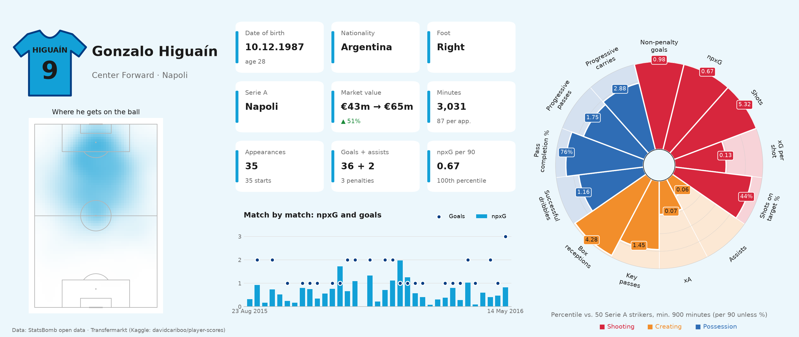

# Player Report: Gonzalo Higuaín, Napoli 2015/16



A one-page scouting report built from **StatsBomb open data** (every on-ball event of the season) and **Transfermarkt** (profile and market values). The example is Gonzalo Higuaín's record-breaking 2015/16 Serie A season, but the pipeline works for any player in a StatsBomb open-data league season: change one id.

## Findings

- **The best chance-getter in the league by a distance.** 0.67 non-penalty xG per 90, against 0.52 for the next Serie A striker.
- **Finishing on top of volume.** 33 non-penalty goals from 22.7 npxG, about 10 more than an average finisher would score from the same chances. His xG per shot was only around the median (0.13), so the goals came from shooting often (5.3 shots per 90, the most of any striker) and finishing well.
- **A creator without the assists.** 49 key passes (78th percentile per 90), but only 2.5 xA and 2 assists: he set up plenty of shots, mostly low-quality ones.
- **The market agreed.** His Transfermarkt value went from €43m before the season to €65m in the summer update, a few weeks before Juventus paid his €90m release clause.

## What's on the report

| Element | Source | Notes |
|---|---|---|
| Shirt, name, position | StatsBomb lineups, Transfermarkt | Shirt in club colours with surname and number, instead of a photo |
| Date of birth, foot | Transfermarkt | Matched to StatsBomb automatically by name and nationality |
| Market value | Transfermarkt | Last value before his first match → first summer update after his last |
| Appearances, minutes, goals, assists | StatsBomb events | Assists are StatsBomb's: only the pass directly before the goal |
| npxG per 90 | StatsBomb events | Replaces the proprietary "average rating" of commercial reports |
| Heatmap | StatsBomb events | Passes, receptions, carries, shots and dribbles |
| Match by match | StatsBomb events | npxG and goals for every appearance |
| Percentile pizza | StatsBomb events | 13 per-90 metrics vs. players in the same position group with 900+ minutes in the league |

### Metric definitions

- **Non-penalty** goals, shots and xG leave out penalties; xG is StatsBomb's.
- **xA**: xG of the shots a player's passes set up.
- **Box receptions**: passes received inside the opposition penalty box.
- **Progressive passes / carries**: completed open-play passes, and carries, that end at most 75% as far from goal as they started.
- Players who changed club mid-season are combined into one row before per-90 values and percentiles are calculated.

## Project structure

```
├── notebooks/
│   └── higuain_2015_16.ipynb   # the full pipeline (start here)
├── player_report/              # report-specific code
│   ├── transfermarkt.py   # Transfermarkt download, player matching, market values (cached)
│   ├── summary.py         # the facts behind the info cards
│   ├── radar.py           # percentile pizza (metric list, groups, colours)
│   ├── colours.py         # club colours and readable text on top of them
│   └── figure.py          # the one-page layout
├── data/
│   └── club_colours.csv   # primary/secondary colour per club (hand-checked)
├── figures/               # saved reports
└── pyproject.toml
```

The StatsBomb side (loading, minutes, positions, per-90 metrics) lives in [`statsbomb_tools`](https://github.com/macrohaitink/statsbomb-pass-network), the package from my pass network project, which this project installs as a dependency.

## Running it

Requires Python 3.10+ (developed on 3.14).

```bash
git clone <this repository>
cd Player_Report
python -m venv .venv
source .venv/bin/activate
pip install -e . jupyterlab ipywidgets
jupyter lab
```

Open `notebooks/higuain_2015_16.ipynb` and run all cells. The first run downloads the Transfermarkt dataset (via `kagglehub`) and all 380 matches of the season (about 1.4 GB, cached in `data/cache/`); later runs read from the cache.

To make a report for another player, change `PLAYER_ID` in the settings cell; for another league or season, change `COMPETITION_ID` and `SEASON_ID`. The pizza currently uses striker metrics for every position, and `data/club_colours.csv` covers Serie A 2015/16 clubs only.

## Data and credits

- Event data: [StatsBomb open data](https://github.com/statsbomb/open-data)
- Player profiles and market values: [Transfermarkt](https://www.transfermarkt.com), via the Kaggle dataset [davidcariboo/player-scores](https://www.kaggle.com/datasets/davidcariboo/player-scores)
- Club colours: partly from [colorr](https://github.com/lobsterbush/colorr) (MIT)
- Pitch and pizza charts: [mplsoccer](https://mplsoccer.readthedocs.io/)
